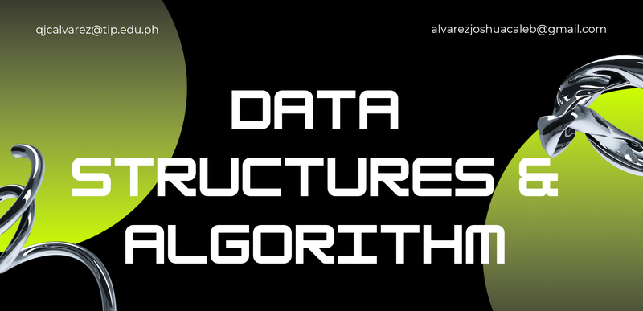

 

# Data Structures and Algorithms E-Portfolio

Welcome to my portfolio, showcasing my C++ implementations, data structures, and algorithm analysis.

## Technological Institute of the Philippines

**Click PRELIM, MIDTERM or FINALS on the banner above to open that term's folder.**

---

## Student Information

| Information | Details |
|---|---|
| **Name** | Joshua Caleb P. Alvarez |
| **Section** | CPE21S1 |
| **Course** | CPE-010 – Data Structures and Algorithms |
| **Program** | Bachelor of Science in Computer Engineering |
| **Instructor** | Engr. Jimlord Quejado |
| **Contact** | [qjcalvarez@tip.edu.ph](mailto:qjcalvarez@tip.edu.ph) · [alvarezjoshuacaleb@gmail.com](mailto:alvarezjoshuacaleb@gmail.com) |

## About this course

CPE-010 teaches how to solve computational problems by organizing data efficiently: algorithm complexity, core data structures (stacks, queues, linked lists, trees, heaps, graphs), searching and hashing, and sorting. The goal is to design algorithms for each data structure and apply them in C++ programs that solve real engineering problems.

Read the full course description

 

This course focuses on solving computational problems that manipulate collected data, studying a core set of data abstractions, data structures, and algorithms that provide a foundation for writing efficient programs. The course content includes theoretical topics in algorithmic efficiency and complexity, along with abstract data types, including graphs, networks, trees (including binary and multi-way trees), heaps, stacks, and priority queues. Search topics, including hashing, trees, external search trees (B-trees), and fundamentals of sorting algorithms with external sorting are introduced and compared. The student's outcome is to design algorithms for each data structure and to use data structures and algorithms in the design of an effective program or software application that will solve a particular engineering-related problem using C++.

## About This Repository

This repository contains my hands-on activities, exercises, and projects for CPE-010 – Data Structures and Algorithms at the Technological Institute of the Philippines.

**Academic Year:** 2026–2027

## Progress Tracker

| Term | Activities | Status |
|---|---|---|
| [PRELIM](./PRELIM) | 1.1 – 5.1 | 🔄 In progress |
| [MIDTERM](./MIDTERM) | 6.1 – 9.1 | ⏳ Upcoming |
| [FINALS](./FINALS) | 10.1 – 14.1 | ⏳ Upcoming |

> ✅ Done · 🔄 In progress · ⏳ Upcoming

## Repository Structure

| Folder | Contents |
|---|---|
| [PRELIM](./PRELIM) | Hands-on Activities 1.1 – 5.1 |
| [MIDTERM](./MIDTERM) | Hands-on Activities 6.1 – 9.1 |
| [FINALS](./FINALS) | Hands-on Activities 10.1 – 14.1 |
| [assets](./assets) | Banner and images used in this README |

## Featured Work

### Linear Search: Array vs. Linked List

A C++ program that generates a random dataset, then runs linear search on both an array and a linked list and counts how many comparisons each one needs to find a number.

- **Concepts:** linear search, arrays, linked lists, counting comparisons (time complexity)
- **Code:** [`View source`](./PRELIM)
- **Sample output:**

<!-- Save a screenshot of your program output as assets/linear-search-output.png, then remove these comment markers:

-->

## What I Learned

### PRELIM
- *(Write 2–3 bullets here: what you learned, what was hard, what you'd improve.)*

### MIDTERM
- *(Fill in after the midterm activities.)*

### FINALS
- *(Fill in after the finals activities.)*

## Skills and Tools

C++ · Arrays · Linked Lists · Searching Algorithms · Algorithm Analysis · Git and GitHub · VS Code

---

Made by **Joshua Caleb P. Alvarez** · CPE21S1 · TIP

